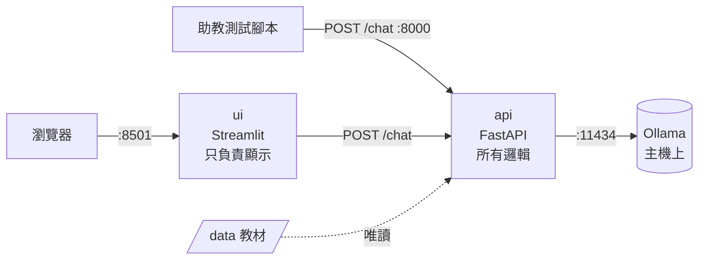
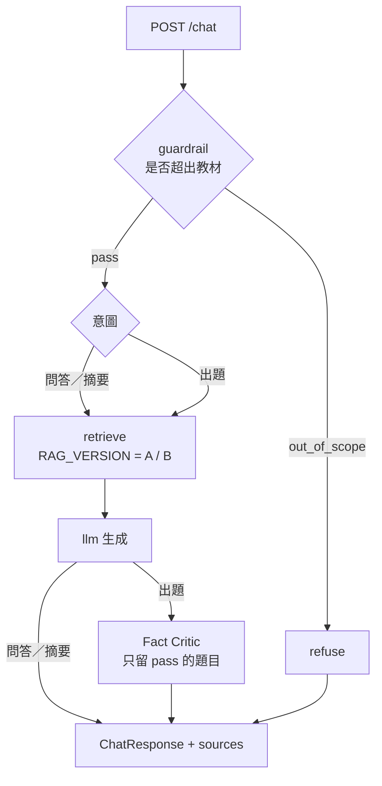

# 開發筆記（教師 AI 助教組）

README 是助教給的通用說明；這份是**我們這組的精簡版**：現在的架構、開發原則、接下來怎麼做。十分鐘內看完即可接手。規格請看 `spec/`。

## 1. 一分鐘總覽

教師 AI 助教：依教材（`data/textbook/`）做 RAG，支援問答、摘要、出題（含 Fact Critic 查核）。



- **ui 沒有任何邏輯**，只呼叫 `/chat`。助教的自動測試直接打 api，不經過 ui。
- **Ollama 裝在主機，不在 Docker 裡**（課程規定）。
- 兩種執行方式，程式碼相同，差別只在環境：


|             | 開發（日常）       | 驗證（繳交前）                               |
| ------------- | -------------------- | ---------------------------------------------- |
| 指令        | `uv run ...`       | `docker compose up --build`                  |
| 用途        | 改程式、馬上看結果 | 確認驗收機上也能跑                           |
| Ollama 位址 | `localhost:11434`  | `host.docker.internal:11434`（compose 設定） |

## 2. 快速開始

```bash
# 一次性：uv（https://docs.astral.sh/uv/getting-started/installation/）與 Ollama（https://ollama.com/download）
ollama pull qwen2.5:3b          # 約 2 GB
uv sync                         # 依 uv.lock 建 .venv（Python 3.12）

# 日常：開兩個終端機，在 repo 根目錄
uv run uvicorn api.app.main:app --reload    # 後端 http://localhost:8000/docs
uv run streamlit run ui/app.py              # 前端 http://localhost:8501

# 測試
uv run python scripts/run_tests.py tests/my_tests.jsonl
uv run python scripts/run_tests.py tests/teacher.jsonl
```

不需要 `.env`。新增套件：`uv add --group api <套件>`（前端用 `--group ui`），`pyproject.toml` 與 `uv.lock` **都要 commit**，不要手動 `pip install`。

## 3. 開發原則

1. **純地端可完整運作**：沒有 `.env`、沒有雲端 key 也能跑。雲端只是選用路徑，`route` 欄位要如實回報。
2. **`/chat` 格式不可改**：欄位以 `spec/api-contract.md` 為準，`schemas.py` 只增不改。
3. **設定集中在 `api/app/config.py`**，其他檔案只 `from .config import ...`，不要散落 `os.environ`。
4. **會影響報告數字的設定（`TOP_K`、`RAG_VERSION`、`CHUNK_SIZE`）預設值寫進 `config.py` 並 commit**，不要只放在自己的 `.env`，否則別人重現不了。
5. **所有後端程式碼放在 `api/app/` 底下**：Dockerfile 只複製這個資料夾，放在別處的程式不會進容器。
6. **依賴只有一個來源**：`pyproject.toml` + `uv.lock`。嵌入走 Ollama，**不要引入 PyTorch／sentence-transformers**（image 會膨脹到數 GB，拖慢 10 分鐘內可用的限制）。
7. **先在本機跑通，再用 Docker 驗證**。Docker 出現的錯誤才是 Docker 的問題。
8. **`.env`、API key 絕不 commit**；曾 push 過就立刻到服務商撤銷。

### 設定放哪裡


| 設定                     | 放哪裡                                   | 例子                           |
| -------------------------- | ------------------------------------------ | -------------------------------- |
| 每個人都該一致、影響結果 | `config.py` 預設值（commit）             | `TOP_K`、`RAG_VERSION`         |
| 只有 Docker 裡才不同     | `docker-compose.yml` 的 `environment`    | `OLLAMA_URL`、`DATA_DIR`       |
| 祕密或個人偏好           | `.env`（不 commit，範本 `.env.example`） | `CLOUD_API_KEY`、`LOCAL_MODEL` |

`uv run` 不會自動讀 `.env`，要用時加 `--env-file .env`。換地端模型要先 `ollama pull`，驗收機也要有，並寫進 README。

## 4. 後端架構

### 現況

```text
.
├── pyproject.toml, uv.lock, .python-version   # 依賴與 Python 版本的唯一來源
├── docker-compose.yml, .dockerignore
├── api/
│   ├── Dockerfile
│   └── app/
│       ├── main.py        # /health、/chat（不用動）
│       ├── schemas.py     # 回傳格式（欄位名稱不可改）
│       ├── config.py      # 所有設定
│       └── pipeline.py    # 目前所有邏輯的位置（空殼，TODO 待實作）
├── ui/{Dockerfile, app.py}
├── data/                  # 助教教材（容器內為唯讀的 /data）
├── tests/                 # 公開題與自訂題（jsonl）
├── scripts/run_tests.py
├── spec/                  # 助教規格
└── docs/{dev-note.md, midterm-report.md}
```

### 規劃（實作時再建檔，不要預先建空檔案）

教師組的功能很多，全塞進 `pipeline.py` 會變成難以分工的大檔案。`pipeline.py` 只保留**流程調度**，功能拆到各模組：

```text
api/app/
├── pipeline.py            # 調度：決定走哪條路、串起下面的模組
├── llm.py                 # 呼叫 Ollama／雲端，集中處理 route
├── guardrail.py           # out_of_scope 判斷
├── rag/
│   ├── chunking.py        # 依 ### 段落 id 切塊，每塊記錄涵蓋的所有段落 id
│   ├── index.py           # 嵌入（Ollama）與建立索引
│   └── retrieve.py        # 基本版 A／改良版 B，由 RAG_VERSION 切換
└── teacher/
    ├── questions.py       # 出題
    └── critic.py          # Fact Critic（期末）
```



基本版 A 與改良版 B 各自獨立，才能公平比較命中率（期中 30 分的部分）。

### RAG 索引的存放（已決定）

教材很小（`data/textbook/` 只有一個檔案，切完約數十個 chunk），因此：

- **索引放記憶體**（`numpy` 向量 + `rank_bm25`），服務啟動或第一次請求時用 Ollama 嵌入後建立，**不寫檔案、不用向量資料庫**。
- 若日後真的需要快取到磁碟，用**具名 volume** 掛到 `/cache`，並在 Dockerfile 先 `mkdir /cache && chown nonroot /cache`（見第 6 節的實測）。**不要寫進 `/app`**。
- 若啟動時建索引，要同步延長 compose 的 `healthcheck.start_period`（目前 10 秒）。

## 5. 期中進度（11/1 23:59，詳見 `spec/midterm.md`）

建議順序，每步都能獨立驗證：

- [ ]  1. `rag/chunking.py` + 小腳本印出每個 chunk 的段落 id，確認切得對
- [ ]  2. `rag/index.py`、`rag/retrieve.py` 基本版 A，打通 `/chat` 並回傳 `sources[].id`
- [ ]  3. 自訂評測集 ≥ 10 題（每題標示應命中的段落 id；現在 `tests/my_tests.jsonl` 只有 2 題）
- [ ]  4. `scripts/eval_retrieval.py`：自動算兩版 Top-K 命中率
- [ ]  5. 改良版 B（更換切塊、混合檢索或重排序），用數據比較
- [ ]  6. 至少一個教師情境完整可用（摘要或教材問答）
- [ ]  7. 失敗案例 ≥ 2 個、跑 `tests/teacher.jsonl` 並附輸出、`docs/midterm-report.md`（含 AI 使用揭露）
- [ ]  8. README 註明模型（含嵌入模型）；`docker compose up --build` 完整驗證
- [ ]  9. `git tag midterm && git push origin midterm`，填繳交表

不在期中範圍：護欄（`guardrail` 欄位需存在，可固定 `pass`）、Fact Critic、Agent。

## 6. Docker 筆記

```bash
docker compose up --build        # 建置並啟動
curl -s localhost:8000/health    # 預期 {"status":"ok"}
docker compose down
```

**何時要 `--build`**：改了程式、`pyproject.toml`、`uv.lock`、Dockerfile。只改 `docker-compose.yml` 設定或 `data/` 教材則不用（教材是掛載的）。

**設計重點**

- 基底 `python:3.12-slim-trixie`（固定 Debian 版本，避免悄悄升級）；`uv` 固定版本複製進來。
- 依賴安裝用 bind mount（`uv.lock`、`pyproject.toml`、`.python-version`）加 cache mount，最終 image 不殘留這些檔案；`--only-group` 讓 api 與 ui 各自只裝需要的套件。
- 執行用 `PATH=/app/.venv/bin`，不用 `uv run`（`uv run` 啟動時會同步所有預設 group）。
- ui 等 api 通過 `/health` 健康檢查才啟動（`depends_on: service_healthy`）。
- 容器連主機 Ollama：`extra_hosts: host.docker.internal:host-gateway` 只解決名稱；**Linux 還需要 Ollama 監聽 `0.0.0.0`**（`OLLAMA_HOST=0.0.0.0`，見 README 疑難排解）。

**注意事項**

- **port 只綁 `127.0.0.1`**。Docker 發佈的 port 會繞過 ufw，綁全部介面會讓實驗室伺服器上的 api 暴露在外網。助教與組員在自己電腦用 `localhost` 不受影響；在伺服器上開發則用 VS Code 轉發或 `ssh -L 8501:localhost:8501`。
- **compose 與 `uv run` 不能同時跑**：兩者都用 8000，後啟動的會 `address already in use`。
- **容器以非 root 使用者（`nonroot`，uid 999）執行**。實測的寫入規則：


| 寫入位置                                 | 結果                        |
| ------------------------------------------ | ----------------------------- |
| `/app`                                   | ❌ 拒絕（唯讀）             |
| `/tmp`                                   | ✅                          |
| image 內預先 `chown nonroot` 的目錄      | ✅                          |
| 具名 volume 掛到該目錄                   | ✅（繼承 image 內的擁有者） |
| bind mount 主機資料夾（擁有者 uid 1001） | ❌ 拒絕                     |

  所以要持久化寫入時，用**具名 volume，不要 bind mount 主機資料夾**。

- 驗證狀態：2026-10-14 已用 `docker compose up --build` 完整驗證（`/health`、ui 健康檢查、`POST /chat` 經容器內 api 呼叫主機 Ollama、多輪對話）。**實作 RAG 後須重新完整驗證**。

## 7. 協作約定

- 各自用自己的帳號 commit（個人貢獻依 commit 紀錄評估）；目前開發分支 `dev/wang`。
- 規格有疑問以 `spec/` 與助教 repo 為準。
