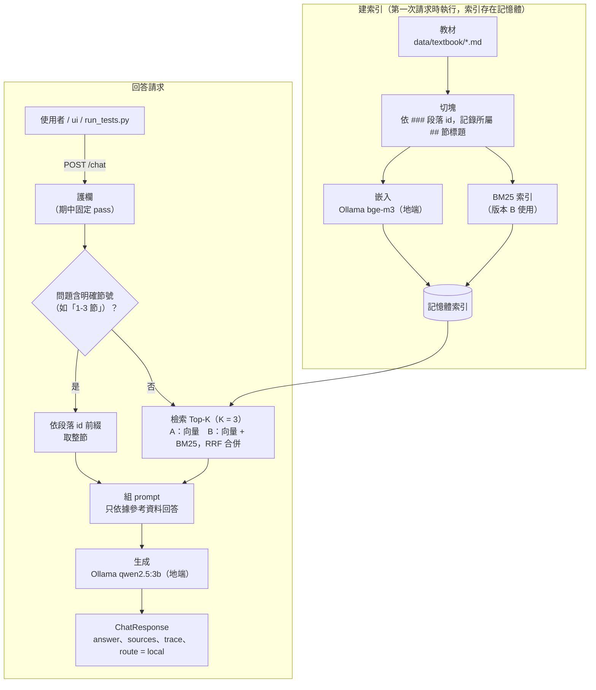

# 期中報告

- 組別角色：教師 AI 助教
- 組員：
  - 王文和
  - 林祐任
- 繳交 commit：以 `midterm` tag 指向的 commit 為準（報告本身包含在該 commit 內，無法寫入自己的 commit hash）

## 1. 系統架構



- **切塊、索引：** 在 `api/app/rag/chunking.py`、`index.py`。服務啟動後第一次請求才建索引，不寫檔案、不用向量資料庫。
- **檢索：** `api/app/rag/retrieve.py`，由 `RAG_VERSION` 切換 A 或 B；查詢也用 `bge-m3` 嵌入。「N-N 節」的整節取用（`section_chunks`）在檢索之前判斷，不屬於 A 或 B。
- **生成：** `api/app/pipeline.py` 組 prompt 後呼叫主機上的 Ollama `qwen2.5:3b`。
- **走地端模型的路徑：** 嵌入（`bge-m3`）與生成（`qwen2.5:3b`）都經由主機的 Ollama，目前沒有雲端路徑，所以 `route` 固定為 `local`。
- **部署：** `docker compose` 啟動 `ui`（Streamlit，只負責顯示）與 `api`（FastAPI，所有邏輯）；容器內以 `host.docker.internal:11434` 連主機的 Ollama，教材以唯讀方式掛載到 `/data`。

## 2. 設計決定與理由

| 項目 | 選擇 | 理由 |
| --- | --- | --- |
| 切塊方式 | 依 `###` 段落 id 切塊，一段一塊；每塊另記所屬 `##` 節標題 | 教材已用 `###` 加段落 id 分段，每段講一個概念，切塊的 id 可直接當 `sources[].id`。`##`、`#` 標題會結束目前段落，沒有 id 的「本章範圍說明」不成為切塊 |
| 切塊大小（字元） | 21 塊，每塊 125～238 字元，平均約 173 | 沿用教材自己的分段，不再切細或合併。整份教材約 8 KB，每塊都很短，K = 3 約 500 字元，放得進 3B 模型的上下文。沒有實測其他切塊大小，這是沒有比較過的選擇 |
| 嵌入模型 | `bge-m3`（經 Ollama，1024 維） | 支援中文，查詢與文件都不需要加前綴或指令；約 5.7 億參數，符合 3B 以下的限制；透過 Ollama 呼叫，不必引入 PyTorch 讓 image 膨脹。沒有實測其他嵌入模型（如 `qwen3-embedding:0.6b`、`nomic-embed-text`），所以不能說它是最好的 |
| K 值 | 3 | 起初是估計值，事後在 24 題上比較 K = 1、2、3、5，Top-K 命中題數 A 為 21、23、23、24，B 為 20、24、24、24。B 在 K = 2 就已全部命中，K = 2、3、5 的命中題數與覆蓋率（0.77、0.76、0.77）幾乎沒有差別，所以這份評測集**無法證明 K = 3 優於 K = 2**；我們維持 3，是因為沿用原先的估計、多留一塊的餘裕給評測集沒涵蓋的問題，且 K 再大只會增加塞給 3B 模型的無關段落（K = 5 沒有更好）。A 要到 K = 5 才全部命中。題數少，差距只有 1 題，不是強證據。問題含「N-N 節」時改為取整節（最多 5 塊），不受 K 限制 |
| 檢索方法 | 預設版本 B：向量檢索與 BM25 以 RRF 合併，索引文字加上節標題，並保證向量第 1 名一定進入 Top-K | 純向量對夾雜指令用語的句子較不穩（`my-002` 的「難度簡單一點」讓 A 的 Top-3 只有例題 1-2-3，沒有 1-2-1、1-2-2 兩條公理本文，覆蓋 1/3；B 三段都有，覆蓋 3/3），BM25 補上字面比對；RRF 只看名次，不需要調權重。「保證向量第 1 名進入 Top-K」是因為 BM25 只比對字面，會被「方程式」這類通用詞帶偏（見第 5 節的 teacher-012）。代價是排名平手時次序由實作決定（見第 5 節）。BM25 斷詞用「連續英數為一詞、中文相鄰兩字」，不用斷詞套件，少一個依賴 |
| 依節號取整節 | 問題含明確節號（「N-N 節」，也認「章、小節、單元、部分」等單位詞與 `– — .` 分隔符號）時，直接取該節所有段落 | 節標題不在切塊內，按節號查詢無法靠相似度找到（第 5 節的失敗案例）。這是一條寫死的規則，不屬於 A 或 B，只認「數字-數字 + 單位詞」的寫法，限制見第 5 節末 |
| 地端模型 | `qwen2.5:3b`（Ollama，temperature 0.2） | 課程預設且符合 3B 以下的限制。system prompt 要求只依據參考資料回答、沒有就說教材中沒有提到；低溫度讓回答貼近原文。沒有與其他模型比較，已知限制是摘要可能漏掉段落、偶爾補上教材沒有的推測句 |

## 3. 兩個版本

| | 版本 A（基本版） | 版本 B（改良版） |
| --- | --- | --- |
| 差異 | 索引文字就是切塊原文；純向量檢索，依 `bge-m3` 餘弦相似度取前 K 塊 | 索引文字前面加上所屬節標題（如「1-3 移項法則」）；向量排名與 BM25 排名以 RRF（常數 60）合併後取前 K 塊；若向量檢索的第 1 名沒有進入前 K，用它取代最後一塊。回傳的 `sources` 仍是原文 |
| 如何切換執行 | 環境變數 `RAG_VERSION=A`，例如 `RAG_VERSION=A uv run uvicorn api.app.main:app`；Docker 則在 `.env` 加一行 `RAG_VERSION=A` | 環境變數 `RAG_VERSION=B`（`api/app/config.py` 的預設值），做法同左。評測可用 `scripts/eval_retrieval.py --version A` 或 `--version B` |

兩版共用同一套切塊、嵌入模型與生成流程，差別只在索引文字與排序方式。B 是否加節標題的對照如下（以臨時腳本計算，未納入 repo；同一份 24 題、K = 3）：

| | Top-3 命中 | Top-1 命中 | 多段題覆蓋率 |
| --- | --- | --- | --- |
| A | 23/24 | 21/24 | 0.60 |
| B，不加節標題 | 23/24 | 22/24 | 0.64 |
| B，加節標題（預設） | 24/24 | 20/24 | 0.76 |

加節標題讓 Top-3 多對 1 題、覆蓋率提高 0.12，但 Top-1 少對 2 題（主要是 RRF 平手，見第 5 節）。「保證向量第 1 名進入 Top-K」不改變這 24 題的成績。完整的逐題結果見第 4 節：Top-3 命中 A 23/24、B 24/24（A 唯一未中的是 my-026，它在實際系統中由「依節號取整節」規則處理），Top-1 命中 A 21/24、B 20/24，多段題覆蓋率 A 0.60、B 0.76。差距只有 1 題左右，且 B 的 Top-1 較少是 RRF 平手造成的（第 5 節）。助教公開題 teacher-012 曾在 B 下未通過，已用「保證向量第 1 名進入 Top-K」修正（第 5 節）；選 B 為預設是取捨後的決定，理由見第 5 節。

## 4. 評測集與命中紀錄

`tests/my_tests.jsonl` 共 30 題，題型與比例比照公開題 `tests/teacher.jsonl`：出題 12、範圍外 6、摘要 8、備課問答 4。其中 24 題標有應命中的段落 id，可用於檢索評測；另外 6 題範圍外題沒有對應段落，只用於護欄測試（`run_tests.py`），不列入下表。「應命中」是對照教材原文標註的，列出多個代表任一個都算命中。K = 3，嵌入模型 `bge-m3`，實際命中依相似度由高到低排列。版本 B 的設定為節標題加混合檢索（BM25 + RRF）。數字可用 `uv run python scripts/eval_retrieval.py <檔案> --version A|B` 重現。

| id | 問題 | 應命中 | 版本 A 實際命中（Top-3） | A 命中？ | 版本 B 實際命中（Top-3） | B 命中？ |
| --- | --- | --- | --- | --- | --- | --- |
| my-001 | 幫我出 4 題一元一次方程式定義的選擇題 | 1-1-2, 1-1-3 | 1-1-3, 1-2-3, 1-4-3 | ✅ | 1-1-3, 1-2-3, 1-1-4 | ✅ |
| my-002 | 出 3 題等量公理的選擇題，難度簡單一點 | 1-2-1, 1-2-2, 1-2-3 | 1-2-3, 1-4-3, 1-3-3 | ✅ | 1-2-3, 1-2-2, 1-2-1 | ✅ |
| my-003 | 針對移項出 3 題選擇題，要包含加減互換 | 1-3-1, 1-3-3, 1-3-4 | 1-3-1, 1-3-2, 1-4-3 | ✅ | 1-3-1, 1-3-3, 1-3-2 | ✅ |
| my-004 | 出 3 題要先把 x 移到同一邊再解的選擇題 | 1-3-1, 1-3-4 | 1-3-4, 1-4-3, 1-3-3 | ✅ | 1-3-4, 1-3-3, 1-3-1 | ✅ |
| my-005 | 出 2 題考驗算的選擇題 | 1-3-5 | 1-4-3, 1-3-5, 1-3-3 | ✅ | 1-5-2, 1-3-5, 1-2-3 | ✅ |
| my-006 | 出 3 題像 3(x+2)-2(x-1)=15 這種含括號的選擇題 | 1-4-1 | 1-4-1, 1-4-3, 1-3-4 | ✅ | 1-4-3, 1-4-1, 1-4-4 | ✅ |
| my-007 | 針對去分母出 2 題選擇題，分母要不一樣 | 1-4-2, 1-4-3 | 1-4-2, 1-4-3, 1-4-1 | ✅ | 1-4-2, 1-4-4, 1-4-1 | ✅ |
| my-008 | 根據講義的常見錯誤，出 3 題能抓出學生漏乘常數項的選擇題 | 1-4-4 | 1-4-4, 1-3-3, 1-4-3 | ✅ | 1-4-4, 1-3-3, 1-3-5 | ✅ |
| my-009 | 我想考學生爸爸和小孩年紀的應用題，出 3 題選擇題 | 1-5-2 | 1-5-2, 1-5-1, 1-4-3 | ✅ | 1-5-1, 1-5-3, 1-5-2 | ✅ |
| my-010 | 出幾題買筆和筆記本算價錢的應用題，選擇題就好 | 1-5-3 | 1-5-3, 1-5-1, 1-3-3 | ✅ | 1-5-3, 1-5-1, 1-5-2 | ✅ |
| my-011 | 幫我出 3 題雞兔同籠或行程問題的選擇題 | 1-5-4, 1-5-5 | 1-5-4, 1-5-5, 1-4-3 | ✅ | 1-5-4, 1-5-5, 1-5-3 | ✅ |
| my-012 | 幫我出一份 5 題的小考，涵蓋移項和去括號 | 1-3-1, 1-3-2, 1-3-3, 1-3-4, 1-4-1 | 1-4-1, 1-3-1, 1-4-3 | ✅ | 1-4-1, 1-4-3, 1-3-3 | ✅ |
| my-019 | 整理移項法則的重點，給學生複習用 | 1-3-1, 1-3-2 | 1-3-1, 1-3-2, 1-4-1 | ✅ | 1-3-2, 1-3-4, 1-3-1 | ✅ |
| my-020 | 把解應用問題的步驟整理成口訣，給學生背 | 1-5-1 | 1-5-1, 1-3-3, 1-4-3 | ✅ | 1-5-1, 1-3-4, 1-3-3 | ✅ |
| my-021 | 學生去分母時常犯哪些錯？ | 1-4-4 | 1-4-4, 1-4-2, 1-5-5 | ✅ | 1-4-4, 1-4-2, 1-5-5 | ✅ |
| my-022 | 整理方程式、未知數和解的基本名詞 | 1-1-1, 1-1-2, 1-1-4 | 1-1-4, 1-1-2, 1-3-4 | ✅ | 1-1-4, 1-1-2, 1-1-3 | ✅ |
| my-023 | 摘要含括號與含分數的方程式怎麼解 | 1-4-1, 1-4-2, 1-4-3 | 1-4-1, 1-1-2, 1-4-3 | ✅ | 1-4-1, 1-4-3, 1-4-2 | ✅ |
| my-024 | 整理驗算怎麼做，以及為什麼要驗算 | 1-3-5 | 1-3-5, 1-4-3, 1-3-3 | ✅ | 1-3-5, 1-4-3, 1-5-3 | ✅ |
| my-025 | 摘要移項法則那一節的重點 | 1-3-1, 1-3-2, 1-3-3, 1-3-4, 1-3-5 | 1-3-1, 1-3-2, 1-4-1 | ✅ | 1-3-2, 1-3-4, 1-3-1 | ✅ |
| my-026 | 幫我摘要 1-5 節的重點 | 1-5-1, 1-5-2, 1-5-3, 1-5-4, 1-5-5 | 1-4-3, 1-3-4, 1-3-3 | ❌ | 1-4-3, 1-5-1, 1-3-3 | ✅ |
| my-027 | 學生問我為什麼移項要變號，講義怎麼解釋？ | 1-2-1, 1-3-1 | 1-3-1, 1-3-2, 1-4-1 | ✅ | 1-3-1, 1-3-5, 1-3-2 | ✅ |
| my-028 | 我想用天平的比喻向學生解釋等式，講義有這段嗎？ | 1-2-1 | 1-4-3, 1-2-1, 1-2-3 | ✅ | 1-2-1, 1-2-2, 1-1-2 | ✅ |
| my-029 | 學生問 5 + 3 = 8 為什麼不是方程式，講義怎麼說？ | 1-1-2 | 1-1-2, 1-1-3, 1-1-4 | ✅ | 1-1-2, 1-1-3, 1-1-4 | ✅ |
| my-030 | 哪個例題適合用來示範等量公理解方程式？ | 1-2-3 | 1-2-3, 1-4-3, 1-2-1 | ✅ | 1-2-3, 1-2-1, 1-2-2 | ✅ |

| tests/my_tests.jsonl | 版本 A | 版本 B |
| --- | --- | --- |
| Top-3 命中率 | 23/24（95.8%） | 24/24（100.0%） |
| Top-1 命中率 | 21/24（87.5%） | 20/24（83.3%） |
| 多段題覆蓋率（n=13） | 0.60 | 0.76 |

說明：

- 「命中」= Top-3 涵蓋的段落 id 含任一個應命中的 id。這對需要多個段落的摘要題太寬鬆，所以另列「多段題覆蓋率」：只看標了多個 id 的題目，覆蓋率 = 找到的標準段落數 / min(3, 標準段落數)。
- 題數很少（24 題，一題約 4 個百分點），且兩版的差距集中在少數題目，數字有雜訊，不宜過度解讀。
- my-026（摘要 1-5 節）在實際系統中由「依節號取整節」的規則處理，不經過 A/B 檢索；保留在這裡是為了重現第 5 節的失敗案例，不應用來比較 A 與 B。
- 「應命中」由 AI 依教材原文草擬，作者審閱後採用（查核方式見第 7 節）。初稿的標註先於檢索結果寫成；之後組員對照教材審閱，指出出題類的題目應該連同例題或講解段落一併標註，我們補上三題：my-002 加 1-2-3（等量公理的例題）、my-004 加 1-3-1（移項的講解）、my-012 加 1-3-2。這次修訂是在看過檢索結果之後做的，而且補標讓 my-002 在版本 A 由未命中變成命中，所以修訂與結果並非完全獨立；本報告的數字（含第 3、5 節）都已用修訂後的標註重新計算。
- my-021（學生去分母常犯哪些錯）可加 1-4-2、my-028（天平比喻）可加 1-2-2，組員認為這兩題較有彈性。我們維持原標註：「命中」只要含任一個應命中的 id，加入次要段落會讓漏掉關鍵段落（my-021 的 1-4-4、my-028 的 1-2-1，後者是教材唯一提到天平的段落）的結果也算通過，評測會變寬鬆。

## 5. 失敗案例

| 問題 | 應命中 | 實際命中 | 假設 | 怎麼驗證 |
| --- | --- | --- | --- | --- |
| `my-005`「出 2 題考驗算的選擇題」；`my-006`「出 3 題像 3(x+2)-2(x-1)=15 這種含括號的選擇題」（版本 B，含節標題） | my-005：1-3-5；my-006：1-4-1 | my-005：1-5-2、1-3-5、1-2-3；my-006：1-4-3、1-4-1、1-4-4。兩題的前兩名 RRF 分數完全相同（0.03252247488101534），Top-3 有命中，但 Top-1 沒中 | 向量排名與 BM25 排名互為鏡像（一個段落向量第 1、BM25 第 2，另一個相反）時，RRF 分數同為 1/61 + 1/62，完全平手。平手時誰排前面由 `argsort` 的內部順序決定（索引大者在前），與內容好壞無關。索引只有 21 段，這種對稱很容易出現 | 已確認：印出前幾名的分數，兩者逐位相同。待做：平手時改以向量相似度為第二排序鍵，重跑 `eval_retrieval.py --version B`，預期 my-005、my-006 的 Top-1 恢復，並確認其他題的 Top-1、Top-3 沒有變差 |
| `my-026`「幫我摘要 1-5 節的重點」（版本 A） | 1-5-1 ～ 1-5-5（第 5 節整節） | A：1-4-3、1-3-4、1-3-3，完全沒有第 5 節的段落（覆蓋 0/3）。B（含節標題）：1-4-3、1-5-1、1-3-3，只靠第 2 名勉強命中（覆蓋 1/3） | 切塊以 `###` 為單位，`##` 節標題（如「1-5 應用問題」）沒有進任何切塊，「1-5 節」在切塊文字中沒有可比對的內容；向量檢索也無法把「1-5」對應到這一節的語意 | 已確認：檢查所有切塊文字，沒有任何一行是 `##` 標題。已驗證的修正：(1) 問題含「N-N 節」時依段落 id 前綴直接取整節（`section_chunks`），teacher-010 的 `sources` 變成 1-3-1 ～ 1-3-5；(2) 版本 B 在索引文字加上節標題：不加時多段題覆蓋率為 0.64，加了之後為 0.76（n=13，對照見第 3 節） |
| `teacher-012`「學生解方程式時常犯哪些錯？」（助教公開題，版本 B，修正前） | 1-4-4 | B：1-1-4、1-1-3、1-1-2，1-4-4 不在前五名；對照 A：1-4-4 排第 1，測試通過 | BM25 斷詞後，問題只剩「解方」「方程」「程式」等詞能比對，而「方程式」是整份教材的主題詞（「方程」、「程式」各出現在 21 塊中的 12 塊）；教材 1-4-4 寫的是「常見的錯誤」，與問題的「常犯」「哪些錯」沒有相同的斷詞，BM25 幾乎給不了分。RRF 把兩份排名相加：向量排第 1、BM25 缺席的 1-4-4 約 0.016 分，低於向量第 2、BM25 第 3 的 1-1-3（約 0.032）。我們的評測集沒有這種只靠通用詞的問題（相近的 my-021 因含「去分母」而正常），這也是評測集的盲點 | 已做：印出向量排名（1-4-4 第 1）與 BM25 排名（前五名沒有 1-4-4），確認 BM25 是來源。**已修正**：版本 B 保證向量第 1 名一定進入 Top-K（見下方比較），修正後 B 的前三名為 1-1-4、1-1-3、1-4-4，teacher-012 通過；但 1-4-4 只排第 3，Top-1 仍不是它 |

第一列（RRF 平手）目前只做了診斷，尚未修改程式；第三列（teacher-012）已修正。第一列修正前 B 的成績為 Top-1 20/24、Top-3 24/24（對照：B 不含節標題為 22/24、23/24；A 為 21/24、23/24）。尚未修正，所以沒有修正後的數字；修正後的數字會另列，不覆蓋此處。

決定預設版本時的比較：排除由「依節號取整節」規則處理的題目（my-026、teacher-010）後，我們的 23 題加上助教公開題 2 題共 25 題，修正 teacher-012 之前 A 的 Top-3 為 25/25、B 為 24/25（B 未命中 teacher-012），修正之後 B 也是 25/25，兩版的 Top-3 沒有差別；Top-1 為 A 23/25、B 20/25，B 較少；B 的優勢只剩多段題覆蓋率（0.81 對 0.68）。標註修訂前，A 曾因 my-002 未中而落後一題，修訂後這個差距消失，所以選 B 的理由比先前更依賴覆蓋率這一項。我們選 B 為預設，理由是教師情境以摘要為主，覆蓋率較重要，並如實保留 B 在 Top-1 的劣勢。

teacher-012 的修正是在看到失敗之後才做的，所以我們比較了幾種做法（同一份 23 題加公開題 2 題，以臨時腳本計算，未納入 repo；已用修訂後的標註重算）：

| 做法 | 我們的 23 題 Top-3 / Top-1 | 多段題覆蓋率 | 公開題 2 題 Top-3 | 結論 |
| --- | --- | --- | --- | --- |
| 修正前的 B | 23/23、20/23 | 0.79 | 1/2（teacher-012 未中） | — |
| 保證向量第 1 名進入 Top-K | 23/23、20/23 | 0.79 | 2/2 | **採用**：沒有任何參數，也沒有讓其他題變差 |
| BM25 忽略出現在過半切塊的詞 | 23/23、20/23 | 0.75 | 2/2 | 也能修好，但覆蓋率較低，且「過半」是人為訂的閾值（修訂標註前，它曾讓 my-004 未中，說明結果對閾值與標註都敏感） |
| 上面兩者合用 | 23/23、20/23 | 0.79 | 2/2 | 沒有比單用第一種更好 |
| BM25 權重降為 0.5 | 23/23、19/23 | 0.72 | 1/2 | 沒修好 |
| BM25 權重降為 0.25 | 23/23、20/23 | 0.72 | 2/2 | 也能修好，但覆蓋率下降 0.07，且權重是要調的參數（修訂標註前，它曾讓 my-002 未中） |

限制：只有 25 題，且是針對 teacher-012 這一題調整，過擬合的風險確實存在；採用的做法沒有可調參數，風險相對較低，但並不代表在隱藏題上一定有效。

**已知限制：「依節號取整節」只認明確的節號。** 組員指出，規則只認「1-3 節」，像「我要 1-2 章的摘要」這種同義說法會取不到，退回一般檢索，摘要會像 my-026 的版本 A 那樣漏掉大半節（第 5 節第二列）。我們已確認並部分修正：規則現在認「節、章、小節、單元、部分」與 `-`、`–`、`—`、`.` 分隔，並容許全形數字與前導 0（`scripts/test_section_ref.py`，21 個案例）。仍然取不到的說法，以及刻意不處理的原因：

| 說法 | 為什麼沒處理 |
| --- | --- |
| 「整理 1-4 的重點」（沒有單位詞） | 會把算式（如「5-3」）誤認成節號 |
| 「摘要移項法則那一節」（用節名稱） | 可以比對 `##` 標題，但「移項」也出現在一般問題裡，需要判斷意圖才準 |
| 「第三節」「第一章」 | 中文數字不知是哪一章；教材整本就是第一章，取整章會把 21 段全塞進 3B 模型的提示 |

這些問題的根本解法是意圖分類（例如讓模型判斷「是否要整節摘要、哪一節」），取代規則比對，列為期末待辦；現在的規則只是縮小缺口，並沒有解決。

## 6. 公開測試題結果

執行環境：2026-10-29 重跑，`docker compose up --build` 啟動，commit `83ecf82`（含標註修訂與整節取用規則的修改），預設設定（`RAG_VERSION=B`、K = 3、`bge-m3`、`qwen2.5:3b`）。指令與輸出：

```
uv run python scripts/run_tests.py tests/teacher.jsonl
FAIL  teacher-001
      questions 應有 5 題，實際為 0 題
FAIL  teacher-002
      questions 應有 3 題，實際為 0 題
FAIL  teacher-003
      questions 應有 2 題，實際為 0 題
FAIL  teacher-004
      questions 應有 3 題，實際為 0 題
FAIL  teacher-005
      questions 應有 2 題，實際為 0 題
FAIL  teacher-006
      guardrail.triggered 應為 True，實際為 False
      guardrail.category 應為 'out_of_scope'，實際為 None
      guardrail.action 應為 'refuse'，實際為 'pass'
FAIL  teacher-007
      guardrail.triggered 應為 True，實際為 False
      guardrail.category 應為 'out_of_scope'，實際為 None
      guardrail.action 應為 'refuse'，實際為 'pass'
FAIL  teacher-008
      guardrail.triggered 應為 True，實際為 False
      guardrail.category 應為 'out_of_scope'，實際為 None
      guardrail.action 應為 'refuse'，實際為 'pass'
FAIL  teacher-009
      guardrail.triggered 應為 True，實際為 False
      guardrail.category 應為 'out_of_scope'，實際為 None
      guardrail.action 應為 'refuse'，實際為 'pass'
PASS  teacher-010
PASS  teacher-011
PASS  teacher-012

分層統計
  in_scope       0/5
  out_of_scope   0/4
  summary        3/3
  總計           3/12
```

與 2026-10-24（commit `801a37a`）的結果逐題相同，3/12。同一份環境另跑了 `tests/my_tests.jsonl`（30 題）：in_scope 1/12、out_of_scope 0/6、summary 8/8、teaching 4/4，總計 13/30。in_scope 的 1 題是 my-010，它的題目沒有指定題數（「出幾題」），所以只檢查來源與護欄欄位就過了，不代表出題功能可用；同樣，出題與護欄未實作，其餘 17 題的失敗原因與公開題相同。另外，`POST /chat`「我要1-2章的摘要」在容器內回傳 `sources` 為 1-2-1、1-2-2、1-2-3（整節取用規則生效）。

這次沒有重做的驗證：10 分鐘內可用的計時（映像層有快取，從 `docker compose up -d --build` 到 api healthy 約 15 秒，不能代表全新環境），以及 ui 的畫面。

主要的失敗原因：

- **`in_scope` 0/5（teacher-001～005）：** 出題功能尚未實作，回傳的 `questions` 是空的，所以題數不符。出題與 Fact Critic 不在期中範圍。
- **`out_of_scope` 0/4（teacher-006～009）：** 護欄尚未實作，`guardrail` 一律回傳 `pass`，沒有拒絕。護欄不在期中範圍，期中只要求欄位存在。
- **`summary` 3/3：** 全部通過。teacher-012 在版本 B 曾經失敗，修正的過程見第 5 節。
- **通過不代表內容完整：** 測試只檢查 `sources` 含任一個指定段落。teacher-010 由「依節號取整節」規則處理，`sources` 涵蓋 1-3 節全部段落，但人工檢視回答時發現，3B 模型的摘要可能漏掉部分段落（例如 1-3 節的回答沒有涵蓋 1-3-5 驗算）。teacher-012 的 `sources` 雖含 1-4-4，它只排第 3。

## 7. AI 使用揭露

| 用在哪裡 | 使用的工具 | 用途 | 查核方式 |
| --- | --- | --- | --- |
| 模型選擇 | Claude Code | 比較嵌入模型（`bge-m3`、`nomic-embed-text`、`qwen3-embedding`）的差異並提出建議；說明 3B 限制下生成模型的選擇 | 上網查證模型規格與使用方式，檢視 Claude Code 的說法；再請 Claude Code 重新稽核 |
| 專案架構決策 | Claude Code | 討論並設計 RAG 管線：切塊方式、索引放記憶體而非向量資料庫、混合檢索（BM25 + RRF）、依節號取整節的規則、K 值與預設版本的取捨 | 上網查證 BM25、RRF、向量資料庫等說法；請 Claude Code 重新稽核；決策另以 `scripts/eval_retrieval.py` 的實測數字檢視 |
| 程式實作 | Claude Code | 撰寫 `api/app/rag/`、`pipeline.py` 的檢索與生成流程、`scripts/show_chunks.py`、`scripts/eval_retrieval.py`、`scripts/test_section_ref.py` | 請 Claude Code 重新稽核；實際執行評測腳本、公開測試與 `docker compose` 驗證 |
| 測試 | Claude Code | 擬定評測集題目與「應命中」的段落 id（`tests/my_tests.jsonl`），設計評測指標（Top-K 命中率、多段題覆蓋率） | 作者審閱題目清單後採用；上網查證評測概念；請 Claude Code 重新稽核；初稿標註先於檢索結果寫成，之後經組員對照教材審閱補標三題（見第 4 節說明） |
| 文檔撰寫 | Claude Code | 撰寫本報告、`docs/dev-note.md`、`README.md` 的草稿 | 上網查證技術說法；請 Claude Code 重新稽核；第 4 節的表格與數字由腳本產生，可用 `eval_retrieval.py` 重現 |
