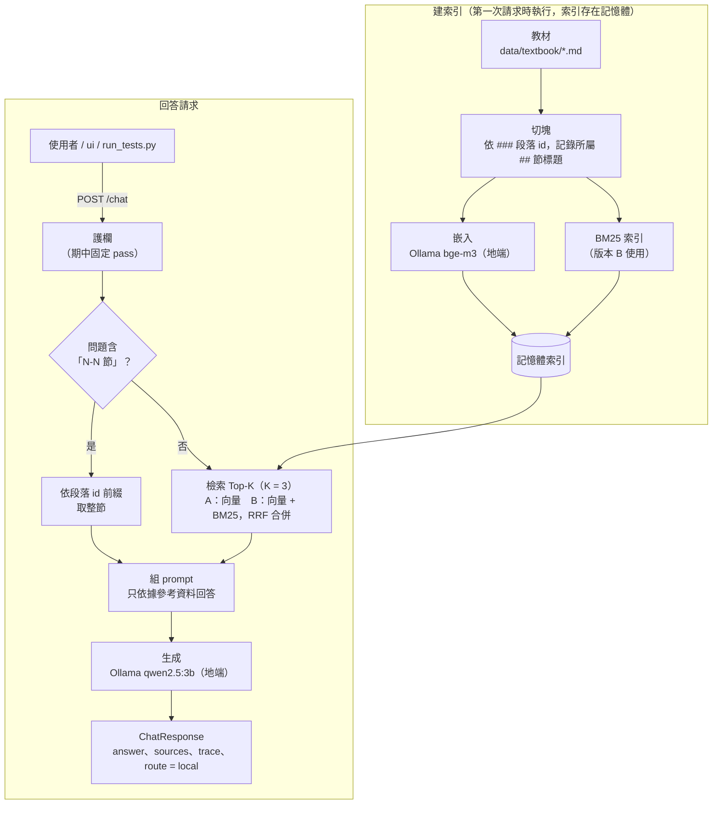

# 期中報告

> 繳交前請刪除所有 `>` 開頭的說明文字。

- 組別角色：（學生 AI 家教 / 教師 AI 助教 / 家長 AI 幫手 / 校長 AI 決策助手）
- 組員：（姓名、學號、GitHub 帳號）
- 繳交 commit：（`git rev-parse midterm` 的結果）

## 1. 系統架構



- **切塊、索引：** 在 `api/app/rag/chunking.py`、`index.py`。服務啟動後第一次請求才建索引，不寫檔案、不用向量資料庫。
- **檢索：** `api/app/rag/retrieve.py`，由 `RAG_VERSION` 切換 A 或 B；查詢也用 `bge-m3` 嵌入。「N-N 節」的整節取用（`section_chunks`）在檢索之前判斷，不屬於 A 或 B。
- **生成：** `api/app/pipeline.py` 組 prompt 後呼叫主機上的 Ollama `qwen2.5:3b`。
- **走地端模型的路徑：** 嵌入（`bge-m3`）與生成（`qwen2.5:3b`）都經由主機的 Ollama，目前沒有雲端路徑，所以 `route` 固定為 `local`。
- **部署：** `docker compose` 啟動 `ui`（Streamlit，只負責顯示）與 `api`（FastAPI，所有邏輯）；容器內以 `host.docker.internal:11434` 連主機的 Ollama，教材以唯讀方式掛載到 `/data`。

## 2. 設計決定與理由

| 項目 | 選擇 | 理由 |
| --- | --- | --- |
| 切塊方式 | 依 `###` 段落 id 切塊，一段一塊；每塊另記所屬 `##` 節標題 | 教材已用 `###` 加段落 id 分段，每段講一個概念，切塊的 id 可直接當 `sources[].id`。`##`、`#` 標題會結束目前段落，沒有 id 的「本章範圍說明」不成為切塊 |
| 切塊大小（字元） | 21 塊，每塊 125～238 字元，平均約 173 | 沿用教材自己的分段，不再切細或合併。整份教材約 8 KB，每塊都很短，K = 3 約 500 字元，放得進 3B 模型的上下文。沒有實測其他切塊大小，這是沒有比較過的選擇 |
| 嵌入模型 | `bge-m3`（經 Ollama，1024 維） | 支援中文，查詢與文件都不需要加前綴或指令；約 5.7 億參數，符合 3B 以下的限制；透過 Ollama 呼叫，不必引入 PyTorch 讓 image 膨脹。沒有實測其他嵌入模型（如 `qwen3-embedding:0.6b`、`nomic-embed-text`），所以不能說它是最好的 |
| K 值 | 3 | 起初是估計值，事後在 24 題上比較 K = 1、2、3、5，Top-K 命中題數 A 為 20、22、22、23，B 為 19、23、24、24。B 在 K = 3 已全部命中，K = 5 沒有再進步，而 K 越大，塞給 3B 模型的無關段落越多；K = 2 則少 1 題。題數少，差距只有 1 題，不是強證據。問題含「N-N 節」時改為取整節（最多 5 塊），不受 K 限制 |
| 檢索方法 | 預設版本 B：向量檢索與 BM25 以 RRF 合併，索引文字加上節標題 | 純向量對夾雜指令用語的句子較不穩（`my-002` 的「難度簡單一點」讓 A 沒命中），BM25 補上字面比對；RRF 只看名次，不需要調權重。代價是排名平手時次序由實作決定（見第 5 節）。BM25 斷詞用「連續英數為一詞、中文相鄰兩字」，不用斷詞套件，少一個依賴 |
| 依節號取整節 | 問題含「N-N 節」時，直接取該節所有段落 | 節標題不在切塊內，按節號查詢無法靠相似度找到（第 5 節的失敗案例）。這是一條寫死的規則，不屬於 A 或 B，只認「數字-數字 節」的寫法 |
| 地端模型 | `qwen2.5:3b`（Ollama，temperature 0.2） | 課程預設且符合 3B 以下的限制。system prompt 要求只依據參考資料回答、沒有就說教材中沒有提到；低溫度讓回答貼近原文。沒有與其他模型比較，已知限制是摘要可能漏掉段落、偶爾補上教材沒有的推測句 |

## 3. 兩個版本

| | 版本 A（基本版） | 版本 B（改良版） |
| --- | --- | --- |
| 差異 | 索引文字就是切塊原文；純向量檢索，依 `bge-m3` 餘弦相似度取前 K 塊 | 索引文字前面加上所屬節標題（如「1-3 移項法則」）；向量排名與 BM25 排名以 RRF（常數 60）合併後取前 K 塊。回傳的 `sources` 仍是原文 |
| 如何切換執行 | 環境變數 `RAG_VERSION=A`，例如 `RAG_VERSION=A uv run uvicorn api.app.main:app`；Docker 則在 `.env` 加一行 `RAG_VERSION=A` | 環境變數 `RAG_VERSION=B`（`api/app/config.py` 的預設值），做法同左。評測可用 `scripts/eval_retrieval.py --version A|B` |

兩版共用同一套切塊、嵌入模型與生成流程，差別只在索引文字與排序方式。成績比較見第 4 節：Top-3 命中 A 22/24、B 24/24，Top-1 命中 A 20/24、B 19/24，多段題覆蓋率 A 0.58、B 0.74。差距只有 1～2 題，且 B 的 Top-1 較少是 RRF 平手造成的（第 5 節）。

## 4. 評測集與命中紀錄

`tests/my_tests.jsonl` 共 30 題，題型與比例比照公開題 `tests/teacher.jsonl`：出題 12、範圍外 6、摘要 8、備課問答 4。其中 24 題標有應命中的段落 id，可用於檢索評測；另外 6 題範圍外題沒有對應段落，只用於護欄測試（`run_tests.py`），不列入下表。「應命中」是對照教材原文標註的，列出多個代表任一個都算命中。K = 3，嵌入模型 `bge-m3`，實際命中依相似度由高到低排列。版本 B 的設定為節標題加混合檢索（BM25 + RRF）。數字可用 `uv run python scripts/eval_retrieval.py <檔案> --version A|B` 重現。

| id | 問題 | 應命中 | 版本 A 實際命中（Top-3） | A 命中？ | 版本 B 實際命中（Top-3） | B 命中？ |
| --- | --- | --- | --- | --- | --- | --- |
| my-001 | 幫我出 4 題一元一次方程式定義的選擇題 | 1-1-2, 1-1-3 | 1-1-3, 1-2-3, 1-4-3 | ✅ | 1-1-3, 1-2-3, 1-1-4 | ✅ |
| my-002 | 出 3 題等量公理的選擇題，難度簡單一點 | 1-2-1, 1-2-2 | 1-2-3, 1-4-3, 1-3-3 | ❌ | 1-2-3, 1-2-2, 1-2-1 | ✅ |
| my-003 | 針對移項出 3 題選擇題，要包含加減互換 | 1-3-1, 1-3-3, 1-3-4 | 1-3-1, 1-3-2, 1-4-3 | ✅ | 1-3-1, 1-3-3, 1-3-2 | ✅ |
| my-004 | 出 3 題要先把 x 移到同一邊再解的選擇題 | 1-3-4 | 1-3-4, 1-4-3, 1-3-3 | ✅ | 1-3-4, 1-3-3, 1-3-1 | ✅ |
| my-005 | 出 2 題考驗算的選擇題 | 1-3-5 | 1-4-3, 1-3-5, 1-3-3 | ✅ | 1-5-2, 1-3-5, 1-2-3 | ✅ |
| my-006 | 出 3 題像 3(x+2)-2(x-1)=15 這種含括號的選擇題 | 1-4-1 | 1-4-1, 1-4-3, 1-3-4 | ✅ | 1-4-3, 1-4-1, 1-4-4 | ✅ |
| my-007 | 針對去分母出 2 題選擇題，分母要不一樣 | 1-4-2, 1-4-3 | 1-4-2, 1-4-3, 1-4-1 | ✅ | 1-4-2, 1-4-4, 1-4-1 | ✅ |
| my-008 | 根據講義的常見錯誤，出 3 題能抓出學生漏乘常數項的選擇題 | 1-4-4 | 1-4-4, 1-3-3, 1-4-3 | ✅ | 1-4-4, 1-3-3, 1-3-5 | ✅ |
| my-009 | 我想考學生爸爸和小孩年紀的應用題，出 3 題選擇題 | 1-5-2 | 1-5-2, 1-5-1, 1-4-3 | ✅ | 1-5-1, 1-5-3, 1-5-2 | ✅ |
| my-010 | 出幾題買筆和筆記本算價錢的應用題，選擇題就好 | 1-5-3 | 1-5-3, 1-5-1, 1-3-3 | ✅ | 1-5-3, 1-5-1, 1-5-2 | ✅ |
| my-011 | 幫我出 3 題雞兔同籠或行程問題的選擇題 | 1-5-4, 1-5-5 | 1-5-4, 1-5-5, 1-4-3 | ✅ | 1-5-4, 1-5-5, 1-5-3 | ✅ |
| my-012 | 幫我出一份 5 題的小考，涵蓋移項和去括號 | 1-3-1, 1-3-3, 1-3-4, 1-4-1 | 1-4-1, 1-3-1, 1-4-3 | ✅ | 1-4-1, 1-4-3, 1-3-3 | ✅ |
| my-019 | 整理移項法則的重點，給學生複習用 | 1-3-1, 1-3-2 | 1-3-1, 1-3-2, 1-4-1 | ✅ | 1-3-2, 1-3-4, 1-3-1 | ✅ |
| my-020 | 把解應用問題的步驟整理成口訣，給學生背 | 1-5-1 | 1-5-1, 1-3-3, 1-4-3 | ✅ | 1-5-1, 1-3-4, 1-3-3 | ✅ |
| my-021 | 學生去分母時常犯哪些錯？ | 1-4-4 | 1-4-4, 1-4-2, 1-5-5 | ✅ | 1-4-4, 1-4-2, 1-5-5 | ✅ |
| my-022 | 整理方程式、未知數和解的基本名詞 | 1-1-1, 1-1-2, 1-1-4 | 1-1-4, 1-1-2, 1-3-4 | ✅ | 1-1-4, 1-1-2, 1-1-3 | ✅ |
| my-023 | 摘要含括號與含分數的方程式怎麼解 | 1-4-1, 1-4-2, 1-4-3 | 1-4-1, 1-1-2, 1-4-3 | ✅ | 1-4-1, 1-4-3, 1-4-2 | ✅ |
| my-024 | 整理驗算怎麼做，以及為什麼要驗算 | 1-3-5 | 1-3-5, 1-4-3, 1-3-3 | ✅ | 1-3-5, 1-4-3, 1-5-3 | ✅ |
| my-025 | 摘要移項法則那一節的重點 | 1-3-1, 1-3-2, 1-3-3, 1-3-4, 1-3-5 | 1-3-1, 1-3-2, 1-4-1 | ✅ | 1-3-2, 1-3-4, 1-3-1 | ✅ |
| my-026 | 幫我摘要 1-5 節的重點 | 1-5-1, 1-5-2, 1-5-3, 1-5-4, 1-5-5 | 1-4-3, 1-3-4, 1-3-3 | ❌ | 1-4-3, 1-5-1, 1-3-3 | ✅ |
| my-027 | 學生問我為什麼移項要變號，講義怎麼解釋？ | 1-2-1, 1-3-1 | 1-3-1, 1-3-2, 1-4-1 | ✅ | 1-3-1, 1-3-5, 1-3-2 | ✅ |
| my-028 | 我想用天平的比喻向學生解釋等式，講義有這段嗎？ | 1-2-1 | 1-4-3, 1-2-1, 1-2-3 | ✅ | 1-2-1, 1-2-2, 1-1-2 | ✅ |
| my-029 | 學生問 5 + 3 = 8 為什麼不是方程式，講義怎麼說？ | 1-1-2 | 1-1-2, 1-1-3, 1-1-4 | ✅ | 1-1-2, 1-1-3, 1-1-4 | ✅ |
| my-030 | 哪個例題適合用來示範等量公理解方程式？ | 1-2-3 | 1-2-3, 1-4-3, 1-2-1 | ✅ | 1-2-3, 1-2-1, 1-2-2 | ✅ |

| tests/my_tests.jsonl | 版本 A | 版本 B |
| --- | --- | --- |
| Top-3 命中率 | 22/24（91.7%） | 24/24（100.0%） |
| Top-1 命中率 | 20/24（83.3%） | 19/24（79.2%） |
| 多段題覆蓋率（n=12） | 0.58 | 0.74 |

說明：
- 「命中」= Top-3 涵蓋的段落 id 含任一個應命中的 id。這對需要多個段落的摘要題太寬鬆，所以另列「多段題覆蓋率」：只看標了多個 id 的題目，覆蓋率 = 找到的標準段落數 / min(3, 標準段落數)。
- 題數很少（24 題，一題約 4 個百分點），且兩版的差距集中在少數題目，數字有雜訊，不宜過度解讀。
- my-026（摘要 1-5 節）在實際系統中由「依節號取整節」的規則處理，不經過 A/B 檢索；保留在這裡是為了重現第 5 節的失敗案例，不應用來比較 A 與 B。
- 「應命中」由 AI 依教材原文草擬，作者審閱後採用（查核方式見第 7 節）；標註先於檢索結果寫成，沒有因結果而回頭修改。

## 5. 失敗案例

> 至少 2 個。只寫「找不到」不算，要寫出假設與驗證方法。

| 問題 | 應命中 | 實際命中 | 你的假設 | 怎麼驗證 |
| --- | --- | --- | --- | --- |
| `my-005`「出 2 題考驗算的選擇題」；`my-006`「出 3 題像 3(x+2)-2(x-1)=15 這種含括號的選擇題」（版本 B，含節標題） | my-005：1-3-5；my-006：1-4-1 | my-005：1-5-2、1-3-5、1-2-3；my-006：1-4-3、1-4-1、1-4-4。兩題的前兩名 RRF 分數完全相同（0.03252247488101534），Top-3 有命中，但 Top-1 沒中 | 向量排名與 BM25 排名互為鏡像（一個段落向量第 1、BM25 第 2，另一個相反）時，RRF 分數同為 1/61 + 1/62，完全平手。平手時誰排前面由 `argsort` 的內部順序決定（索引大者在前），與內容好壞無關。索引只有 21 段，這種對稱很容易出現 | 已確認：印出前幾名的分數，兩者逐位相同。待做：平手時改以向量相似度為第二排序鍵，重跑 `eval_retrieval.py --version B`，預期 my-005、my-006 的 Top-1 恢復，並確認其他題的 Top-1、Top-3 沒有變差 |
| `my-026`「幫我摘要 1-5 節的重點」（版本 A） | 1-5-1 ～ 1-5-5（第 5 節整節） | A：1-4-3、1-3-4、1-3-3，完全沒有第 5 節的段落（覆蓋 0/3）。B（含節標題）：1-4-3、1-5-1、1-3-3，只靠第 2 名勉強命中（覆蓋 1/3） | 切塊以 `###` 為單位，`##` 節標題（如「1-5 應用問題」）沒有進任何切塊，「1-5 節」在切塊文字中沒有可比對的內容；向量檢索也無法把「1-5」對應到這一節的語意 | 已確認：檢查所有切塊文字，沒有任何一行是 `##` 標題。已驗證的修正：(1) 問題含「N-N 節」時依段落 id 前綴直接取整節（`section_chunks`），teacher-010 的 `sources` 變成 1-3-1 ～ 1-3-5；(2) 版本 B 在索引文字加上節標題，多段題覆蓋率由 0.64 升到 0.74（n=12） |

上表第一列尚未修正，修正前 B 的成績為 Top-1 19/24、Top-3 24/24（對照：B 不含節標題為 21/24、23/24；A 為 20/24、22/24）。修正後的數字另列，不覆蓋此處。

## 6. 公開測試題結果

> 執行 `python scripts/run_tests.py tests/<role>.jsonl`，貼上輸出，並說明主要的失敗原因。期中不以通過率計分。

```
（貼上輸出）
```

## 7. AI 使用揭露

| 用在哪裡 | 使用的工具 | 用途 | 查核方式 |
| --- | --- | --- | --- |
| | | | |
