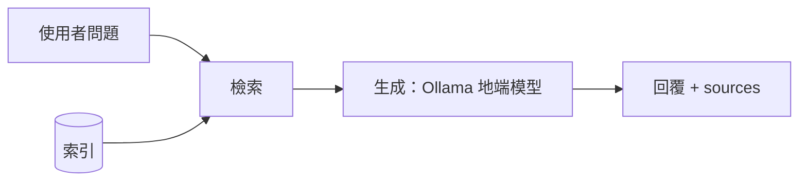

# 期中報告

> 繳交前請刪除所有 `>` 開頭的說明文字。

- 組別角色：（學生 AI 家教 / 教師 AI 助教 / 家長 AI 幫手 / 校長 AI 決策助手）
- 組員：（姓名、學號、GitHub 帳號）
- 繳交 commit：（`git rev-parse midterm` 的結果）

## 1. 系統架構

> 一張圖即可。標出切塊、索引、檢索、生成各在哪裡，以及哪條路徑走地端模型。
> 可以用 Mermaid 直接畫，GitHub 會自動顯示成圖，例如：



## 2. 設計決定與理由

| 項目 | 選擇 | 理由 |
| --- | --- | --- |
| 切塊方式 | | |
| 切塊大小（註明單位：字元或 token） | | |
| 嵌入模型 | | |
| K 值 | | |
| 檢索方法 | | |
| 地端模型 | | |

## 3. 兩個版本

| | 版本 A（基本版） | 版本 B（改良版） |
| --- | --- | --- |
| 差異 | | |
| 如何切換執行 | | |

## 4. 評測集與命中紀錄

> 至少 10 題。「應命中」與「實際命中」都填段落 id。

| # | 問題 | 應命中 | 版本 A 實際命中（Top-K） | A 命中？ | 版本 B 實際命中（Top-K） | B 命中？ |
| --- | --- | --- | --- | --- | --- | --- |
| 1 | | | | | | |
| 2 | | | | | | |
| 3 | | | | | | |
| 4 | | | | | | |
| 5 | | | | | | |
| 6 | | | | | | |
| 7 | | | | | | |
| 8 | | | | | | |
| 9 | | | | | | |
| 10 | | | | | | |

| | 版本 A | 版本 B |
| --- | --- | --- |
| 命中率 | | |

## 5. 失敗案例

> 至少 2 個。只寫「找不到」不算，要寫出假設與驗證方法。

| 問題 | 應命中 | 實際命中 | 你的假設 | 怎麼驗證 |
| --- | --- | --- | --- | --- |
| `my-007`「出 2 題考驗算的選擇題」；`my-008`「出 3 題像 3(x+2)-2(x-1)=15 這種含括號的選擇題」（版本 B，含節標題） | my-007：1-3-5；my-008：1-4-1 | my-007：1-5-2、1-3-5、1-2-3；my-008：1-4-3、1-4-1、1-4-4。兩題的前兩名 RRF 分數完全相同（0.03252247488101534），Top-3 有命中，但 Top-1 沒中 | 向量排名與 BM25 排名互為鏡像（一個段落向量第 1、BM25 第 2，另一個相反）時，RRF 分數同為 1/61 + 1/62，完全平手。平手時誰排前面由 `argsort` 的內部順序決定（索引大者在前），與內容好壞無關。索引只有 21 段，這種對稱很容易出現 | 已確認：印出前幾名的分數，兩者逐位相同。待做：平手時改以向量相似度為第二排序鍵，重跑 `eval_retrieval.py --version B`，預期 my-007、my-008 的 Top-1 恢復，並確認其他題的 Top-1、Top-3 沒有變差 |
| `my-016`「幫我摘要 1-5 節的重點」（版本 A） | 1-5-1 ～ 1-5-5（第 5 節整節） | A：1-4-3、1-3-4、1-3-3，完全沒有第 5 節的段落（覆蓋 0/3）。B（含節標題）：1-4-3、1-5-1、1-3-3，只靠第 2 名勉強命中（覆蓋 1/3） | 切塊以 `###` 為單位，`##` 節標題（如「1-5 應用問題」）沒有進任何切塊，「1-5 節」在切塊文字中沒有可比對的內容；向量檢索也無法把「1-5」對應到這一節的語意 | 已確認：檢查所有切塊文字，沒有任何一行以 `## ` 開頭。已驗證的修正：(1) 問題含「N-N 節」時依段落 id 前綴直接取整節（`section_chunks`），teacher-010 的 `sources` 變成 1-3-1 ～ 1-3-5；(2) 版本 B 在索引文字加上節標題，多段題覆蓋率由 0.64 升到 0.73（n=14） |

上表第一列尚未修正，修正前 B 的成績為 Top-1 28/32、Top-3 32/32（對照：B 不含節標題為 29/32、32/32；A 為 27/32、31/32）。修正後的數字另列，不覆蓋此處。

## 6. 公開測試題結果

> 執行 `python scripts/run_tests.py tests/<role>.jsonl`，貼上輸出，並說明主要的失敗原因。期中不以通過率計分。

```
（貼上輸出）
```

## 7. AI 使用揭露

| 用在哪裡 | 使用的工具 | 用途 | 查核方式 |
| --- | --- | --- | --- |
| | | | |
